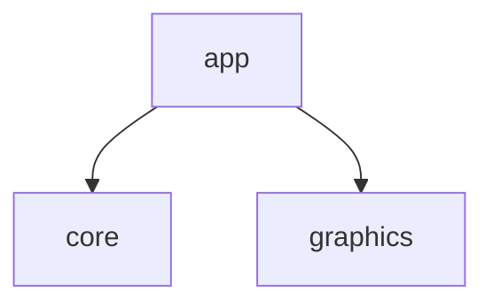

# Flight Sim
## Goals
- Build a small 6-degree-of-freedom flight simulator in modern C++ and OpenGL by March 2027.
- The project will be made solo, about 3 hours a week or 45 hours total. This is why it is a tight scope.
- The project will be “done” when M6 ships: tagged release with README,  a GIF with numbers.

## Scope
### v1 Inlcudes:
- One aircraft with a simple aerodynamic model: lift, drag, thrust, gravity, and control-surface moments for pitch, roll and yaw.
- Keyboard or gamepad controls for throttle, elevator, aileron and rudder.
- A flat ground plane with a grid, a sky gradient, and a low-poly aircraft model.
- A chase camera and a free camera.
- A Dear ImGui panel: live state (altitude, airspeed, angle of attack, attitude), tunable parameters (mass, wing area, lift slope, thrust), pause, step and reset.
- Fixed-timestep simulation, independent of the frame rate.
- Recording and replay of a flight to a file. This is cheap to build, and it makes the sim deterministic and testable.

### Not in v1:
- Realistic aero tables, stalls beyond a simple cutoff, wind or turbulence
- Terrain loading, textures or a lighting model beyond basic shading
- Collision beyond a ground check

## Architecture
The physics library never includes any OpenGL, GLFW, or ImGui.
Dependencies point one way: app -> render -> core.

### Program Jobs
| Job | Needs GL | Needs OS | Headless test |
|-----|:---:|:---:|:---:|
|Window and GL Context| | ✓ | |
|Main Loop| | ✓ | |
|Input Reading| | ✓ | |
|Input Mapping| | | ✓ |
|Aircraft Model (Forces)| | | ✓ |
|Rigid Body| | | ✓ |
|Integrator / Time Stepping| | | ✓ |
|World / Ground Contact| | | ✓ |
|Rendering| ✓ | | |
|Camera| | | ✓ |
|Asset Loading| | ✓ | |
|Debug overlay and Debug Lines| ✓ | | |
|Logging| | ✓ | |
|Recording / Playback| | | ✓ | 
|Replay File| | ✓ | |

Recording and playback chosen to be included for easy retestability. I will
be able to see slight changes to the physics and how they effect the same
run.

### Module Dependencies

### Why this structure
The app relies on the core and graphics, meaning that changes to 
the app leave graphics and the core untouched. Testing can also occur on
core on its own because it depends on nothing. Core and graphics
also don't depend on each other, which means changing core doesn't
rebuild graphics.

