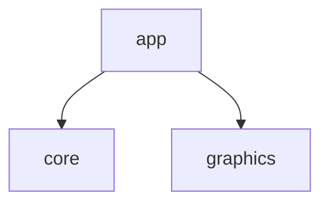

# Flight Sim
## Goals
- Build a small 6-degree-of-freedom flight simulator in modern C++ and OpenGL by March 2027.
- The project will be made solo, about 3 hours a week or 60 hours total. This is why it is a tight scope.
- The project will be “done” when M6 ships: tagged release with README,  a GIF with numbers.

## Scope
### v1 Includes:
- One aircraft with a simple aerodynamic model: lift, drag, thrust, gravity, and control-surface moments for pitch, roll and yaw.
- Keyboard or gamepad controls for throttle, elevator, aileron and rudder.
- A flat ground plane with a grid, a sky gradient, and a low-poly aircraft model.
- A chase camera and a free camera.
- A Dear ImGui panel: live state (altitude, airspeed, angle of attack, attitude), tunable parameters (mass, wing area, lift slope, thrust), pause, step and reset.
- Fixed-timestep simulation, independent of the frame rate.
- Recording and replay of a flight to a file. This is cheap to build, and because the sim is deterministic, can assist in testing physics tweaks.

### Not in v1:
- Realistic aero tables, stalls beyond a simple cutoff, wind or turbulence
- Terrain loading, textures or a lighting model beyond basic shading
- Collision beyond a ground check

## Architecture
Core never includes any OpenGL, GLFW, or ImGui.
Graphics never includes GLFW.

### Program Jobs
| Job | Needs GL | Needs OS | Headless test |
|-----|:---:|:---:|:---:|
|Window and GL Context| | ✓ | |
|Main Loop| | ✓ | |
|Input Reading| | ✓ | |
|Input Mapping| | | ✓ |
|Aircraft Model (Forces)| | | ✓ |
|Rigid Body| | | ✓ |
|Integrator / Time Stepping| | | ✓ |
|World / Ground Contact| | | ✓ |
|Rendering| ✓ | | |
|Camera| | | ✓ |
|Asset Loading| | ✓ | |
|Debug overlay and Debug Lines| ✓ | | |
|Logging| | ✓ | |
|Recording / Playback| | | ✓ | 
|Replay File| | ✓ | |

Recording and playback chosen to be included for easy retestability. I will
be able to see slight changes to the physics and how they affect the same
run.

### Module Dependencies

### Why this structure
The app relies on the core and graphics, meaning that changes to 
the app leave graphics and the core untouched. Testing can also occur on
core on its own because it depends on nothing. Core and graphics
also don't depend on each other, which means changing core doesn't
rebuild graphics.

## Milestones

### M0 — Design, Repo, and Window (Nov 22 · est. 4h)
Done when:
- [ ✓ ] `cmake --build` succeeds from a clean clone
- [ ✓ ] Three targets: core, graphics, app
- [ ] App opens a GLFW window and logs the OpenGL version
- [ ] CI compiles on windows

### M1 — Render Basics (Nov 30 · est. 5h)
Done when:
- [ ] Shader pipeline compiles and links with error checking
- [ ] Ground plane renders
- [ ] Free-fly camera moves with keyboard and mouse
- [ ] ImGui panel shows FPS
- [ ] GL debug output

### M2 — Rigid-Body Core (Dec 14 · est. 10h)
Done when:
- [ ] Rigid body with semi-implicit Euler integrator and fixed-step loop
- [ ] Free-fall test matches the textbook answer
- [ ] Projectile test matches the textbook answer
- [ ] Set up testing framework and CTest

### M3 — Aircraft Forces (Dec 28 · est. 10h)
Done when:
- [ ] GLM rotation.
- [ ] Lift, drag, and thrust applied in the body frame
- [ ] Control moments for pitch, roll, and yaw
- [ ] Trim test holds level flight at cruise speed

### M4 — Fly It (Jan 15 · est. 14h)
Done when:
- [ ] Aircraft mesh renders
- [ ] Chase camera follows the aircraft
- [ ] Controls for throttle, elevator, aileron, and rudder
- [ ] Live telemetry and tuning sliders in ImGui
- [ ] Rendering interpolates smoothly between sim steps

### M5 — Replay and RK4 (Jan 31 · est. 8h)
Done when:
- [ ] Recorded flights replay identically
- [ ] RK4 integrator added behind the same interface
- [ ] RK4 vs Euler drift measured

### M6 — Ship v1.0 (Feb 14 · est. 6h)
Done when:
- [ ] README with GIF and numbers
- [ ] Tagged v1.0 release
- [ ] Added to resume and engineering page

### Stretch — DIS Output (Feb–Mar · est. 10h)
Done when:
- [ ] Sim publishes DIS Entity State packets
- [ ] A second instance shows the aircraft